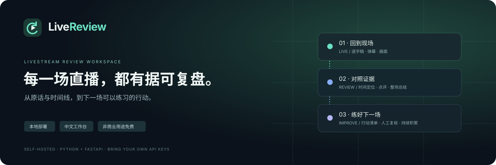
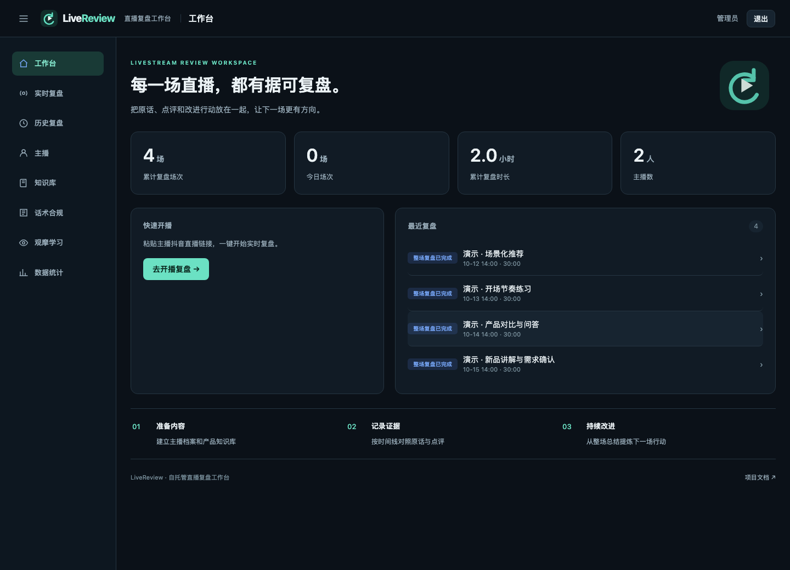
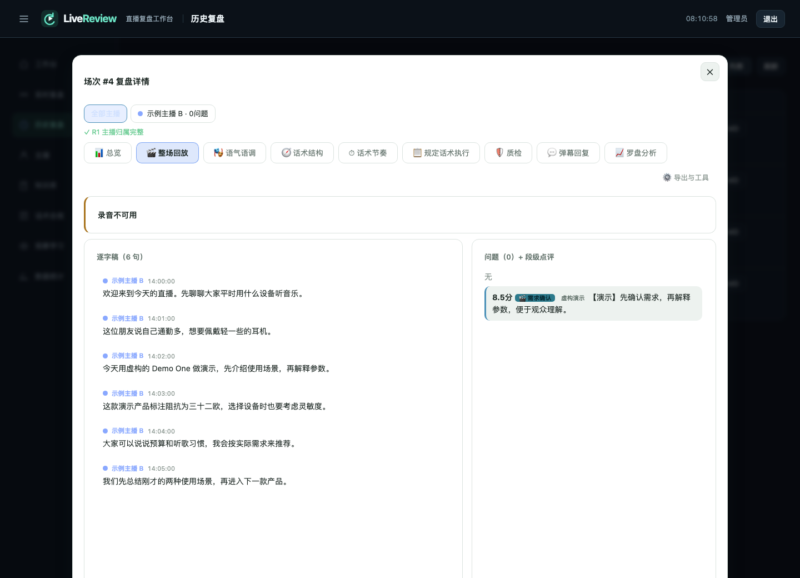
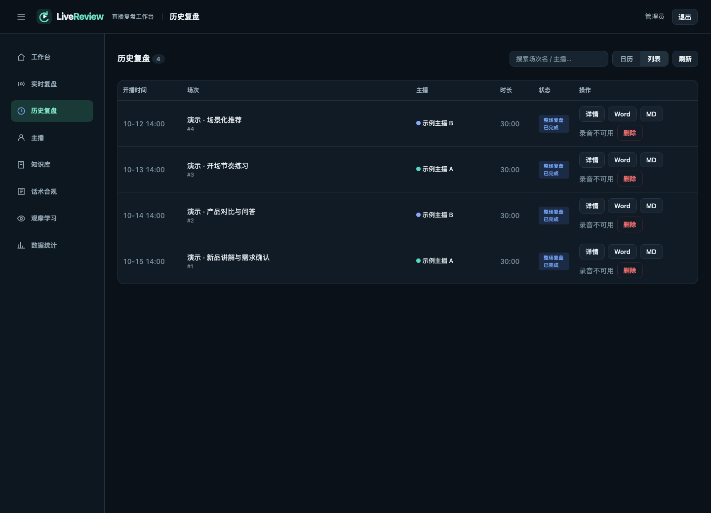
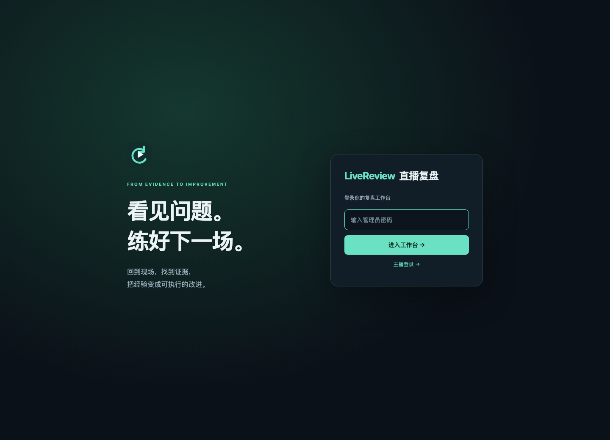

<p align="center"></p>

<p align="center">
  <a href="LICENSE"></a>
  
  
  
</p>

<p align="center"><b>让直播复盘有原话、有时间点、有下一步。</b><br>录制与转写 · 分段点评 · 整场报告 · 主播工作台 · 知识与经验积累</p>

<p align="center"><a href="#快速开始">快速开始</a> · <a href="docs/INSTALL.md">完整安装</a> · <a href="docs/CONFIGURATION.md">模型配置</a> · <a href="docs/ARCHITECTURE.md">技术架构</a> · <a href="docs/FAQ.md">常见问题</a> · <a href="README.en.md">English</a></p>

## 这是什么

LiveReview 是一个可自己部署的中文直播复盘工作台。它把直播中的逐字稿、画面文字、弹幕和点评放到同一条时间线上，再按主播整理整场报告与改进建议，方便运营和主播一起回看、判断与练习。

代码公开，**非商业用途免费；商业使用需另行取得授权**。采用 [PolyForm Noncommercial 1.0.0](LICENSE)，属于源码可见项目。第三方组件沿用各自许可证。项目与直播平台、模型厂商及商品品牌没有官方关联。

## 界面预览

以下截图来自本地实际运行的应用，使用仓库脚本生成的**虚构演示数据**。不是客户记录，也不是一次真实 AI 分析的结果。



<details>
<summary>查看复盘详情、历史列表和登录界面</summary>





</details>

## 能做什么

| 能力 | 工作方式 |
| --- | --- |
| 直播采集 | 输入有权处理的直播链接，拉取媒体；支持多主播轮班归属 |
| 证据时间线 | 查看逐字稿、弹幕、画面文字，以及对应时间点的点评；有录制媒体时可回放 |
| 多层复盘 | 句级规则、分段点评、整场总结和按需深度报告 |
| 知识库 | 维护商品资料、讲解规则；导入文档，为点评提供参考 |
| 主播工作台 | 独立主播账号查看自己的报告与提醒 |
| 经验与节奏 | 累积候选经验、节奏模板，支持人工判断和采纳 |
| 改进动作 | 可选开启跨场动作核对，帮助跟踪下一场的练习情况 |
| 运行控制 | 记录模型用量，按需启用实时点评、自动录制和对象存储 |

部分规则最初围绕耳机讲解设计；跨品类使用时，需要调整知识库、规则和提示词。AI 点评和合规提示供人工复核，不应当作自动处罚或法律结论。


## 快速开始

**先准备：** Git、[uv](https://docs.astral.sh/uv/getting-started/installation/)；配置脚本需要 Python 3。uv 会为后端准备 Python 3.12。录制需要 [FFmpeg](https://ffmpeg.org/download.html)。仅安装并查看演示数据不需要 API key。

### 1. 下载并设置自己的登录密码

```bash
git clone https://github.com/ewinhao-ops/livereview.git
cd livereview
python3 scripts/setup.py
```

Windows 可将最后一行换成 `py scripts/setup.py`。脚本交互设置至少 12 位密码，并生成独立签名密钥，保存到 **`backend/.env`**；已有配置不会被覆盖。

### 2. 安装并启动

```bash
cd backend
uv sync --frozen --no-dev
uv run --no-sync python -m playwright install chromium
uv run --no-sync uvicorn app.main:app --host 127.0.0.1 --port 8765 --no-proxy-headers
```

打开 **[http://localhost:8765](http://localhost:8765)**，输入刚才设置的密码。

第一次打开没有业务记录，这是正常的。想先看完整界面，可停止服务，在 `backend` 目录运行下面的命令，再重新启动：

```bash
uv run --no-sync python ../scripts/seed_demo.py
```

演示脚本只向空数据库写入虚构记录，不调用模型、不录制直播，已有业务数据时会拒绝写入。

### 3. 使用真实直播复盘

在 `backend/.env` 配置自己的 DashScope 转写密钥和大模型服务，按需设置直播平台 Cookie，然后重启。完整示例见 [模型与功能配置](docs/CONFIGURATION.md)。模型服务的费用由你的服务商账号承担。

`/api/health` 只检查服务是否启动；`/api/ready` 检查录制依赖和配置。**未配置模型时 `/api/ready` 返回 503 是预期行为**，不影响登录和查看已有报告。就绪检查不会替你验证账户余额或模型实际调用权限。

### Docker 部署

装好 Docker Engine / Docker Desktop 和 Compose 后，在仓库根目录运行：

```bash
python3 scripts/setup.py
docker compose up -d --build
```

默认只向本机开放 `127.0.0.1:8765`，数据保存在 Docker 卷中。首次构建会下载浏览器依赖。当前已实测 macOS 源码安装，Docker 构建尚未实测。公网 HTTPS、Windows 步骤、备份与升级见 [安装和部署手册](docs/INSTALL.md)。

## 密钥和数据归谁

- 浏览与下载这个 GitHub 仓库无需项目密码；部署后的后台使用你自己的登录密码。
- 模型 key、平台 Cookie、对象存储凭据只放在 `backend/.env` 或服务端环境变量中。
- 仓库不附带可用 API key、真实数据库、录制文件、账号或原始生产环境的 Git 历史。
- 文本和媒体默认保存在自己的机器上。启用云模型时，会将相应音频、文本或画面发送给所选服务商；启用 COS 时，媒体会存到自己的 COS 桶。

详细说明见 [安全与隐私](SECURITY.md)。

## 开发与验证

```bash
cd backend
uv sync --frozen --extra dev
uv run --no-sync pytest -q
cd ..
node --test frontend/tests/*.test.js
```

前端使用原生 JavaScript 和 CSS，不需要 Node 构建；Node 仅用于前端测试。测试覆盖登录与权限、采集生命周期、报告状态、知识规则、数据库迁移及前端交互契约。真实付费 ASR 测试默认跳过。

## 文档

| 文档 | 内容 |
| --- | --- |
| [安装和部署](docs/INSTALL.md) | macOS / Linux / Windows、Docker、HTTPS、升级与备份 |
| [配置说明](docs/CONFIGURATION.md) | 自备密钥、模型选择、费用开关、可选集成 |
| [架构说明](docs/ARCHITECTURE.md) | 目录、数据流、存储和权限 |
| [常见问题](docs/FAQ.md) | 登录、依赖、录制和报告排错 |
| [贡献指南](CONTRIBUTING.md) | 本地开发和问题反馈 |
| [更新记录](CHANGELOG.md) | 公开版本变化 |
| [第三方声明](THIRD_PARTY_NOTICES.md) | 所依赖项目的许可证 |

## 使用许可

原始代码采用 [PolyForm Noncommercial License 1.0.0](LICENSE)。非商业使用、修改和分发需遵守许可证及 [NOTICE](NOTICE)；商业使用需单独取得书面授权。商业授权可通过 [仓库维护者](https://github.com/ewinhao-ops) 联系，或提交不含敏感信息的授权咨询 Issue。
