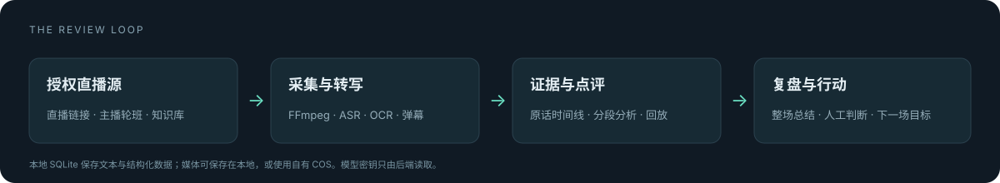

# 技术架构

LiveReview 是一个 Python 后端加原生网页的单服务应用。FastAPI 同时提供 API、WebSocket 和前端文件；默认 SQLite 保存文本与结构化数据，媒体保存在本地或自有 COS。



## 主要目录

```text
backend/
  app/api/          HTTP 与主播、知识库、报告等接口
  app/core/         采集、ASR、OCR、模型调用和复盘流程
  app/core/review/  句级、段级、整场和深度分析
  app/auth.py       独立登录与主播 Cookie
  app/sso.py        可选 Studio 身份适配
  app/models.py     数据结构
  app/db.py         数据库初始化与兼容迁移
  tests/            后端测试
frontend/           无构建步骤的中文工作台与主播页面
scripts/            首次配置、虚构演示数据和本地验收
docs/               安装、配置与项目展示图片
```

## 一场复盘如何处理

1. 录入直播链接与主播，检查真实 ASR、LLM 和本地采集依赖。
2. FFmpeg 拉流并保存媒体，语音转写和可选的画面、弹幕采集分别产生时间戳记录。
3. 按主播上播时段归属记录，用知识库和规则辅助句级、段级分析。
4. 收播后整理音频与整场报告。媒体状态、基础报告状态和深度报告状态分开保存，失败时不冒充完成。
5. 主播与运营对照原话回看。候选经验、节奏模板和改进动作可进一步处理；自动动作核对默认关闭。

## 认证边界

独立模式使用管理员密码和带过期时间的 HMAC 签名 Cookie，设置 HttpOnly 与 SameSite；浏览器写请求检查来源，登录失败有频率限制。管理员角色共享；主播账号使用独立的密码哈希和各自的 Cookie。

机器集成使用各自 token，默认只接受回环请求。签名报告链接有有效期，属于持有链接即可读取的分享机制，应按临时凭证保管。

## 数据与模型

数据库保存转写、点评、主播归属、知识和状态。媒体文件独立存放，SQL 中保存其引用。使用云模型时，所选任务的音频、文本、画面或文档片段会发送给对应服务商；本地部署不等于模型离线运行。

模型适配器允许将高频和深度任务分开配置。用量记录保留提供商、token 和可选估算成本；不把配置存在等同于真实调用成功。

## 已知适用范围

当前以单机、单团队部署为主，默认数据库是 SQLite。多租户隔离、通用组织权限、多机任务队列和完整离线模型部署不在这次公开版本的承诺范围内。部分知识规则来自耳机讲解场景，其他商品类别需要调整规则和提示词。
